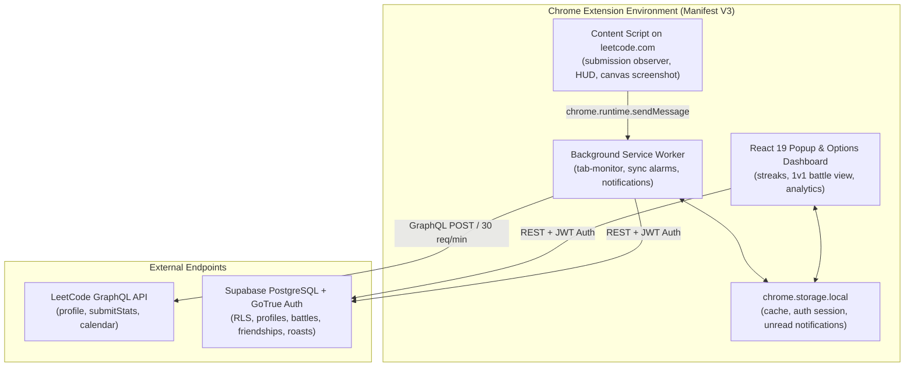

# LeetStreak Advanced Implementation Architecture

## 1. System Overview & Component Topology

---

## 2. Core Subsystems

### A. Autonomous Submission Observer & Content Script
- Located in `src/content/leetcode-integration.js`.
- Observes DOM submission verdict banners on `leetcode.com/problems/*` without external dependencies.
- Extracts problem slug, language, and submission ID.
- Automatically communicates accepted results to service worker for Hardcore Mode solve-to-unlock and live 1v1 battle progress.

### B. Solve-to-Unlock Hardcore Mode Tab Monitor
- Located in `src/background/tab-monitor.js`.
- Listens to `chrome.tabs.onUpdated` and `chrome.tabs.onActivated`.
- Verifies if user has solved a problem today (`isUserSolvedToday()`).
- Unlocks distracting websites for the rest of today once 1 problem is solved.
- Implements path-specific blocking rules (e.g. blocking `/shorts` on YouTube, `/feed` on LinkedIn) while allowing educational tutorials and direct job messages.

### C. Authoritative 1v1 Battle System
- Located in `src/shared/battle-manager.js` and `src/popup/BattleView.jsx`.
- Enforces canonical state machine:
  `PENDING -> ACCEPTED -> SELECTING -> READY_CHECK -> COUNTDOWN -> IN_PROGRESS -> COMPLETED`.
- Both players concurrently access and solve both selected problems in the locked language.
- Deterministic scoring: 1 point per problem, tiebreaker total accepted completion time across completed problems, draw if equal.

### D. Durable Roast Message Delivery
- Located in `src/shared/supabase-client.js` and `src/background/service-worker.js`.
- Roasts between accepted friends are stored in `public.roast_messages`.
- Delivery tracking: `sent` -> `delivered` -> `read`.
- Offline recovery: unread messages are fetched on browser startup / extension reconnect.

### E. Centralized Notification Pipeline
- Located in `src/shared/notification-manager.js`.
- Lifecycle: `QUEUED -> DISPLAY_REQUESTED -> SHOWN / FAILED -> IN_APP_STORED -> DISMISSED / CLICKED`.
- In-app storage fallback in `unread_notifications` ensures notifications are never dropped even if OS permissions are disabled.
