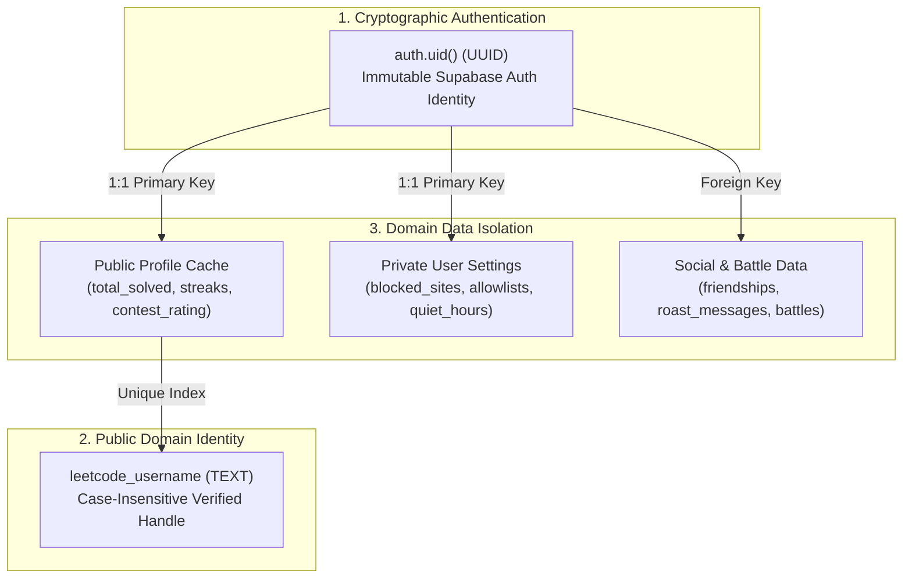

# LeetStreak Advanced Security Architecture

## 1. Identity Model & Authentication Boundaries

### Separation of Concerns
LeetStreak enforces a strict tripartite separation of user identity:



1. **Application User ID (`auth.uid()`, UUID):**
   - Issued by Supabase Auth via signed cryptographic JWT.
   - Evaluated by PostgreSQL Row-Level Security on every PostgREST query.
   - Serves as the sole authorization identity. User-provided strings are never treated as authorization credentials.
2. **LeetCode Username (`leetcode_username`, TEXT):**
   - Linked to `public.profiles(id)` via case-insensitive unique index (`LOWER(leetcode_username)`).
   - Used for public leaderboard indexing and querying LeetCode's public GraphQL API.
   - Verification flow: Users verify handle ownership via unique challenge token (`verification_token`) placed in their public LeetCode profile bio.
3. **Data Access Boundaries:**
   - **Public Profile Data:** `total_solved`, `easy_solved`, `medium_solved`, `hard_solved`, `current_streak`, `longest_streak`, `contest_rating`. Accessible to all users for competitive display.
   - **Private Settings Data:** `blocked_sites`, `path_rules`, `quiet_hours`, `notifications_enabled`. Strictly private to the owner (`auth.uid() = user_id`).

---

## 2. Row-Level Security (RLS) Policy Specifications

### User Settings Table (`user_settings`)
```sql
CREATE POLICY "settings_select_own" 
ON public.user_settings FOR SELECT 
USING (auth.uid() = user_id);

CREATE POLICY "settings_insert_own" 
ON public.user_settings FOR INSERT 
WITH CHECK (auth.uid() = user_id);

CREATE POLICY "settings_update_own" 
ON public.user_settings FOR UPDATE 
USING (auth.uid() = user_id) 
WITH CHECK (auth.uid() = user_id);
```

### Friendships Table (`friendships`)
```sql
CREATE POLICY "friendships_select_participants" 
ON public.friendships FOR SELECT 
USING (auth.uid() = requester_id OR auth.uid() = addressee_id);

CREATE POLICY "friendships_insert_requester" 
ON public.friendships FOR INSERT 
WITH CHECK (auth.uid() = requester_id);
```

### Roast Messages Table (`roast_messages`)
```sql
CREATE POLICY "roasts_select_participants" 
ON public.roast_messages FOR SELECT 
USING (auth.uid() = sender_id OR auth.uid() = recipient_id);

CREATE POLICY "roasts_insert_sender" 
ON public.roast_messages FOR INSERT 
WITH CHECK (
    auth.uid() = sender_id 
    AND sender_id != recipient_id
    AND EXISTS (
        SELECT 1 FROM public.friendships 
        WHERE status = 'accepted' 
        AND ((requester_id = auth.uid() AND addressee_id = recipient_id)
          OR (addressee_id = auth.uid() AND requester_id = recipient_id))
    )
);
```

---

## 3. Trusted Backend Execution via SECURITY DEFINER Functions

To prevent client-side score manipulation, fake submissions, or premature victory claims, competitive transitions are executed via trusted PostgreSQL functions:

### 1. `confirm_battle_ready(p_battle_id UUID)`
- Validates caller is a participant in the match.
- Atomically checks if peer participant is ready.
- Advances state to `countdown` and establishes authoritative synchronized timestamps (`countdown_starts`, `match_starts_at`, `match_deadline`).

### 2. `record_battle_submission(p_battle_id UUID, ...)`
- Validates caller is a participant and match is in `in_progress` status.
- Validates submission language matches locked match language.
- Enforces idempotency via `leetcode_submission_id` unique constraint.
- Ensures maximum 1 point per problem (prevents duplicate points on resubmissions).
- Automatically triggers match finalization when criteria are met.

### 3. `evaluate_and_finalize_battle(p_battle_id UUID)`
- Authoritatively counts accepted problems (1 point each).
- Evaluates completion time tiebreaker.
- Declares winner or draw, preventing client-side winner tampering.

---

## 4. Network Transport Security & HSTS Auditing
`src/shared/https-enforcement.js` validates that:
1. Every outgoing request uses strict `https:`.
2. Communication is restricted to allowlisted endpoints (`leetcode.com`, Supabase instance).
3. HSTS headers are verified on API responses to guard against SSL stripping.
