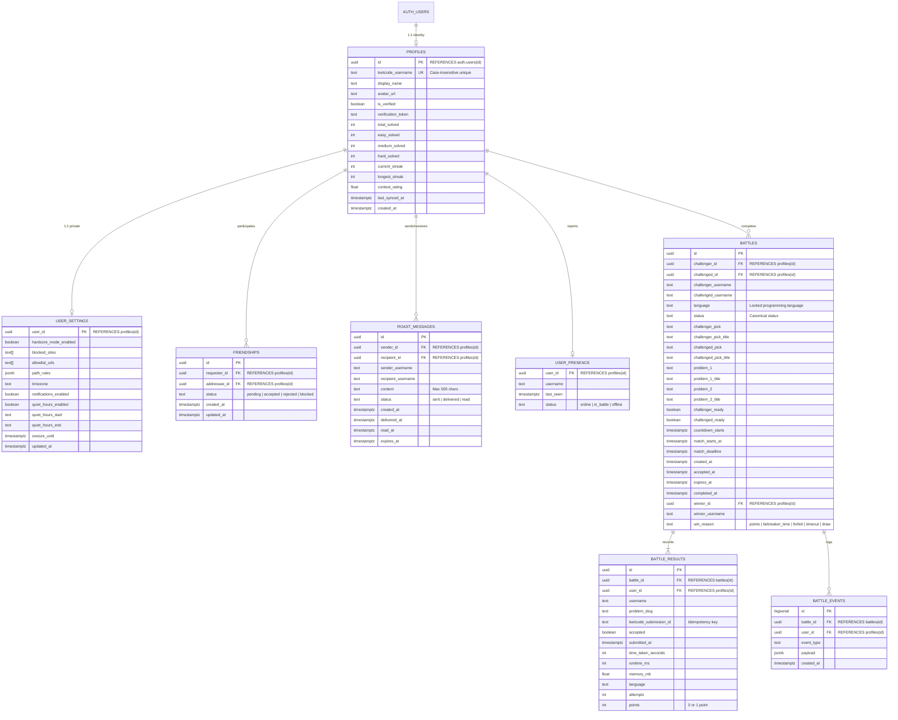
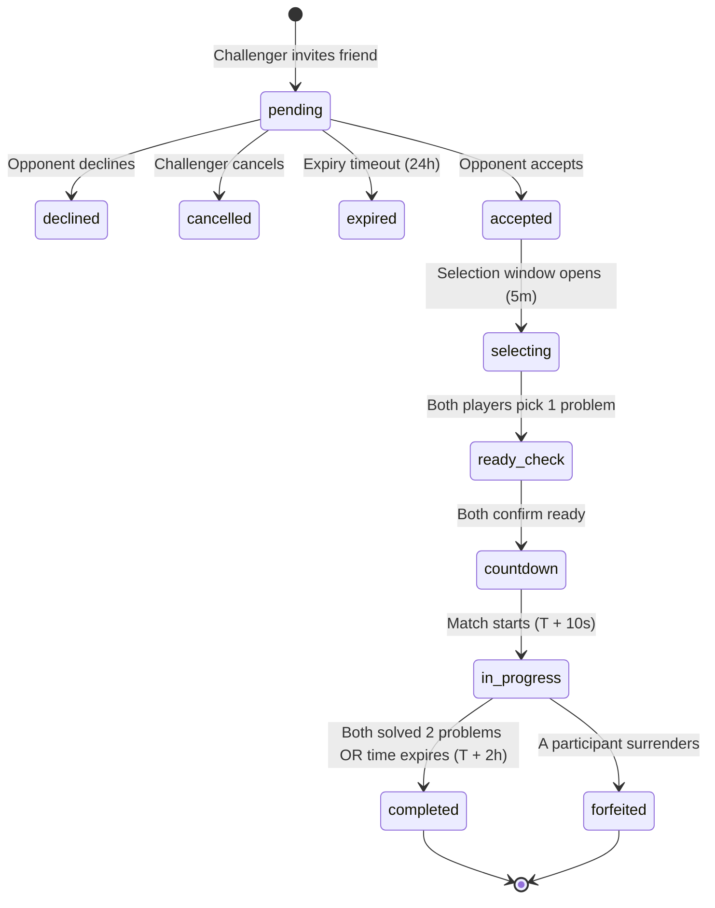

# LeetStreak Database Architecture & SQL Migrations

**Version:** 2.0.0  
**Target Platform:** Supabase PostgreSQL (Postgres 15+)  
**Security Model:** Strict Row-Level Security (RLS) + Authenticated Identity Binding (`auth.uid()`) + Atomic `SECURITY DEFINER` Functions

---

## 1. Relational Entity Diagram



---

## 2. Canonical Status Vocabulary & State Transitions

The database adheres to a single canonical status vocabulary:
`'pending', 'accepted', 'selecting', 'ready_check', 'countdown', 'in_progress', 'completed', 'declined', 'expired', 'cancelled', 'forfeited'`



---

## 3. SQL Migrations & Version Control

Versioned migrations are located under `supabase/migrations/`:
1. **Migration Script:** [`supabase/migrations/20261105000001_security_and_relational_schema.sql`](file:///l:/LeetStreak/supabase/migrations/20261105000001_security_and_relational_schema.sql)
2. **Rollback Script:** [`supabase/migrations/20261105000001_security_and_relational_schema.down.sql`](file:///l:/LeetStreak/supabase/migrations/20261105000001_security_and_relational_schema.down.sql)

### Migration Order & Deployment Instructions
```bash
# Apply migration to remote Supabase project:
npx supabase db push

# Or execute SQL directly via Supabase Dashboard SQL Editor:
# Copy contents of 20261105000001_security_and_relational_schema.sql into SQL Editor and run.
```

---

## 4. Row-Level Security (RLS) Policy Matrix

| Table | Operation | Allowed Identity | RLS Expression |
| :--- | :--- | :--- | :--- |
| `profiles` | `SELECT` | Public / Authenticated | `USING (true)` |
| `profiles` | `INSERT` / `UPDATE` | Owner only | `auth.uid() = id` |
| `user_settings` | `SELECT` / `ALL` | Owner only | `auth.uid() = user_id` |
| `friendships` | `SELECT` / `DELETE` | Mutual participants | `auth.uid() = requester_id OR auth.uid() = addressee_id` |
| `friendships` | `INSERT` | Requester | `auth.uid() = requester_id` |
| `roast_messages` | `SELECT` | Sender or Recipient | `auth.uid() = sender_id OR auth.uid() = recipient_id` |
| `roast_messages` | `INSERT` | Sender (Friend only) | `auth.uid() = sender_id AND EXISTS (accepted friendship)` |
| `roast_messages` | `UPDATE` | Recipient only | `auth.uid() = recipient_id` (mark delivered/read) |
| `battles` | `SELECT` | Match participants | `auth.uid() = challenger_id OR auth.uid() = challenged_id` |
| `battles` | `UPDATE` | Match participants | `auth.uid() IN (challenger, challenged) AND winner_id unchanged` |
| `battle_results` | `SELECT` | Match participants | Verified via parent `battles` relationship |
| `battle_results` | `INSERT` | Participant (Own result)| `auth.uid() = user_id AND active match` |
| `battle_results` | `UPDATE` | Disallowed | Append-only (tamper proof) |
