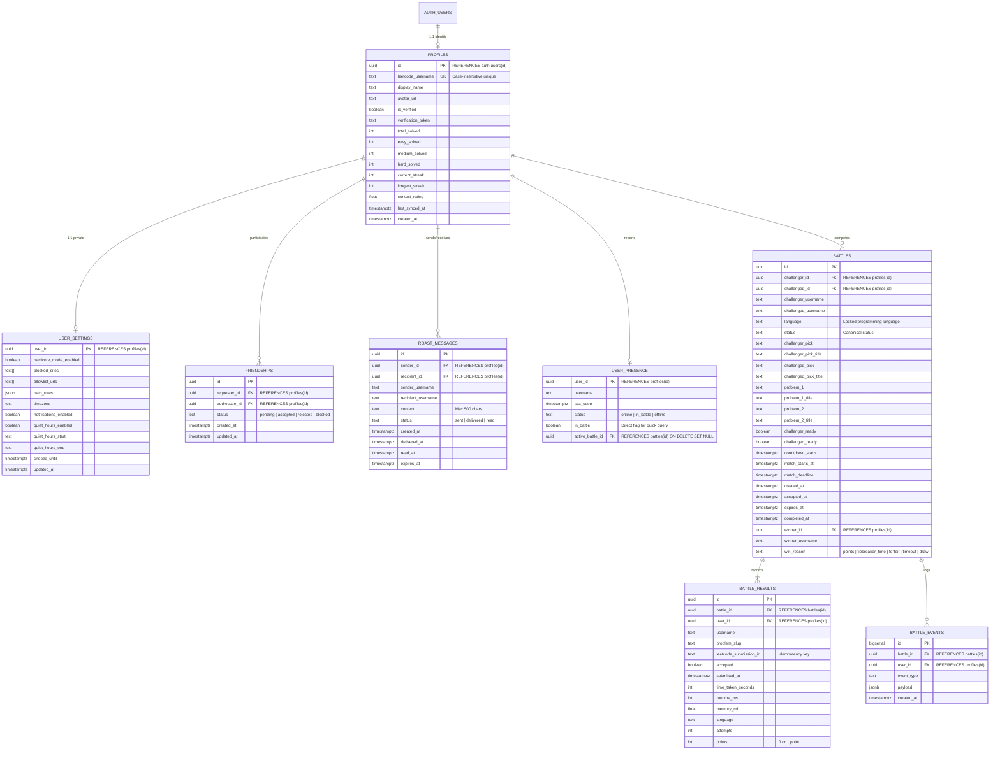
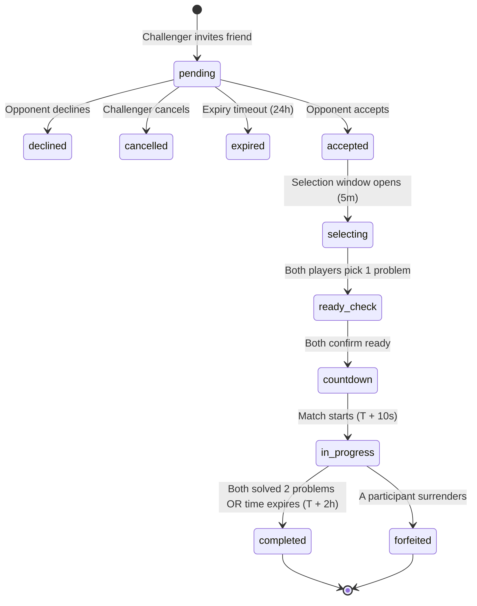

# LeetStreak Database Architecture & SQL Migrations

**Version:** 2.0.0  
**Target Platform:** Supabase PostgreSQL (Postgres 15+)  
**Security Model:** Strict Row-Level Security (RLS) + Authenticated Identity Binding (`auth.uid()`) + Atomic `SECURITY DEFINER` Functions

---

## 1. Relational Entity Diagram

---

## 2. Canonical Status Vocabulary & State Transitions

The database adheres to a single canonical status vocabulary:
`'pending', 'accepted', 'selecting', 'ready_check', 'countdown', 'in_progress', 'completed', 'declined', 'expired', 'cancelled', 'forfeited'`

---

## 3. SQL Migrations & Version Control

Versioned migrations are located under `supabase/migrations/`:
1. **Security & Relational Schema:** [`supabase/migrations/20261105000001_security_and_relational_schema.sql`](file:///l:/LeetStreak/supabase/migrations/20261105000001_security_and_relational_schema.sql)
2. **Presence & Social Remediation:** [`supabase/migrations/20261105000002_presence_and_social_remediation.sql`](file:///l:/LeetStreak/supabase/migrations/20261105000002_presence_and_social_remediation.sql)
   - Rollback Script: [`supabase/migrations/20261105000002_presence_and_social_remediation.down.sql`](file:///l:/LeetStreak/supabase/migrations/20261105000002_presence_and_social_remediation.down.sql)
3. **Permanent Friendship Persistence & Account Recovery:** [`supabase/migrations/20261105000003_permanent_friendship_and_recovery.sql`](file:///l:/LeetStreak/supabase/migrations/20261105000003_permanent_friendship_and_recovery.sql)
   - Rollback Script: [`supabase/migrations/20261105000003_permanent_friendship_and_recovery.down.sql`](file:///l:/LeetStreak/supabase/migrations/20261105000003_permanent_friendship_and_recovery.down.sql)
4. **Battle Redesign:** `supabase/migrations/20261106000001_battle_redesign.sql`
5. **Battle Solve Recording & Performance Tiebreak:** `supabase/migrations/20261106000002_battle_submission_scoring.sql`
6. **Battle History Scoreboard & Filters:** `supabase/migrations/20261107000001_battle_history_scoreboard.sql`
7. **Remove Demo Joy Presence:** `supabase/migrations/20261107000002_remove_demo_joy_presence.sql`
8. **Friend Request Isolation:** `supabase/migrations/20261110000001_friend_request_isolation.sql`
9. **Battle Identity & Write Guards:** `supabase/migrations/20261110000002_battle_identity_and_write_guards.sql`
10. **Revoke Inherited Battle Grants:** `supabase/migrations/20261110000003_revoke_inherited_battle_grants.sql`
11. **Legacy Battle History Labels:** `supabase/migrations/20261110000004_legacy_battle_history_labels.sql`
12. **Presence & Friendship RPC Guards:** `supabase/migrations/20261110000005_presence_friend_requests_and_legacy_rpc_guards.sql`
13. **Server-Verified Battle Solves:** `supabase/migrations/20261110000006_server_verified_battle_solves.sql`
14. **Restore Record Battle Solve RPC:** `supabase/migrations/20261110000007_restore_record_battle_solve_rpc.sql`
15. **Exclude Self-Battles from History:** `supabase/migrations/20261110000008_exclude_self_battles_from_history.sql`
16. **Restore get_online_friends RPC:** `supabase/migrations/20261110000009_restore_get_online_friends.sql`
17. **Ephemeral Roast Messages (Auto-Delete on Delivery):** `supabase/migrations/20261110000010_ephemeral_roast_messages.sql`

### Migration Order & Deployment Instructions
For fresh databases or full upgrades, use the all-in-one generator [`supabase/COMPLETE_DATABASE_SCHEMA.sql`](../supabase/COMPLETE_DATABASE_SCHEMA.sql). It is completely idempotent and safe to run directly in the Supabase Dashboard SQL Editor or via `psql`.

For existing databases needing the latest patch (excluding test self-battles and updating the scoreboard RPC), use [`supabase/RUN_THIS_IN_SUPABASE.sql`](../supabase/RUN_THIS_IN_SUPABASE.sql).

All 15 versioned migrations are tracked chronologically in `supabase/migrations/` and can also be deployed via the Supabase CLI (`npx supabase db push`).

---

## 4. Row-Level Security (RLS) Policy Matrix

| Table | Operation | Allowed Identity | RLS Expression |
| :--- | :--- | :--- | :--- |
| `profiles` | `SELECT` | Public / Authenticated | `USING (true)` |
| `profiles` | `INSERT` / `UPDATE` | Owner only | `auth.uid() = id` |
| `user_settings` | `SELECT` / `ALL` | Owner only | `auth.uid() = user_id` |
| `friendships` | `SELECT` | Mutual participants | `auth.uid() = requester_id OR auth.uid() = addressee_id` |
| `friendships` | `INSERT` / `UPDATE` / `DELETE` | RPC only | Direct authenticated writes revoked; `request_friendship` and `respond_to_friend_request` enforce consent |
| `roast_messages` | `SELECT` | Sender or Recipient | `auth.uid() = sender_id OR auth.uid() = recipient_id` |
| `roast_messages` | `INSERT` | Sender (Friend only) | `auth.uid() = sender_id AND EXISTS (accepted friendship)` |
| `roast_messages` | `UPDATE` | Recipient only | `auth.uid() = recipient_id` (mark delivered/read) |
| `battles` | `SELECT` | Match participants | `auth.uid() = challenger_id OR auth.uid() = challenged_id` |
| `battles` | `INSERT` / `UPDATE` / `DELETE` | RPC only | Direct authenticated writes revoked; battle RPCs verify participant identity |
| `battle_results` | `SELECT` | Match participants | Verified via parent `battles` relationship |
| `battle_results` | `INSERT` / `UPDATE` / `DELETE` | RPC only | Direct authenticated writes revoked; solve RPC verifies authenticated participant and active battle |
