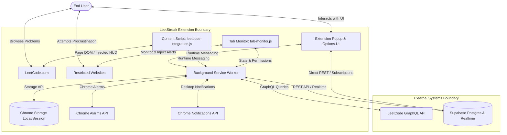

# LeetStreak High-Level Design (HLD)

**Version:** 1.0.0  
**Status:** Approved  
**Author:** Principal Software Architect & Engineering Lead  
**Target Platform:** Chrome Extension Manifest V3, React 19, Supabase, LeetCode GraphQL

---

## 1. System Context & Overview

### 1.1 Mission & Value Proposition
LeetStreak is a browser extension engineered to help software engineers maintain daily coding consistency on LeetCode, compete with peers, track personal progress, and eliminate digital distractions.

### 1.2 User Personas
- **Competitive LeetCoder:** Seeks real-time 1v1 coding battles with friends under locked languages and strict countdowns.
- **Consistency Builder:** Tracks personal streaks, solves the Problem of the Day, and monitors long-term problem breakdown.
- **Focus Seeker:** Uses Hardcore Motivation Mode to block distracting doomscrolling sites until today's LeetCode problem is solved.

### 1.3 System Boundary & External Dependencies



### 1.4 External Dependencies Table

| External System | Interface Type | Role in System | Security / Trust Model |
|---|---|---|---|
| **Chrome Extension APIs** | Manifest V3 API (`runtime`, `storage`, `alarms`, `notifications`, `scripting`, `tabs`) | Host execution environment, storage, background scheduling | High trust, isolated execution sandbox |
| **LeetCode Web Platform** | DOM / Monaco Editor / Network | Source of coding challenges, editor, submission results | Untrusted third-party DOM; sanitized via strict selectors |
| **LeetCode GraphQL API** | HTTPS POST `https://leetcode.com/graphql` | Queries for profile stats, contest ranking, and daily question | Read-only public endpoints; rate-limited |
| **Supabase Cloud** | HTTPS REST / WebSockets Realtime | Durable profile cache, user settings, 1v1 battle rooms & events | Low-trust client access guarded by Row-Level Security |

---

## 2. System Architecture & Component Diagram

The system adheres to Chrome Extension Manifest V3 guidelines. Background processes are event-driven service workers that do not maintain permanent in-memory state.

```mermaid
componentDiagram
    package "Presentation Layer (React 19)" {
        [Popup Container] --> [StreakView]
        [Popup Container] --> [LeaderboardView]
        [Popup Container] --> [AnalyticsView]
        [Popup Container] --> [BattleView]
        [Popup Container] --> [SettingsView]
        [Options Page] --> [FriendManager]
    }

    package "Background & Content Scripts" {
        [Service Worker Orchestrator] --> [Tab Monitor & Blocker]
        [Service Worker Orchestrator] --> [Notification Dispatcher]
        [Service Worker Orchestrator] --> [Sync Scheduler]
        [Content Script] --> [Monaco Code Extractor]
        [Content Script] --> [Submission Verdict Observer]
        [Content Script] --> [Battle HUD Invalidator]
    }

    package "Shared Core Services" {
        [Streak Engine]
        [Battle State Machine]
        [LeetCode Normalizer]
        [Storage & Cache Manager]
    }

    package "Durable Data Stores" {
        database "Chrome Local Storage" as LocalDB
        database "Supabase Cloud DB" as RemoteDB
    }

    [Popup Container] ..> [Service Worker Orchestrator] : Runtime Messaging
    [Content Script] ..> [Service Worker Orchestrator] : Runtime Messaging
    [Service Worker Orchestrator] --> [Streak Engine]
    [Service Worker Orchestrator] --> [Battle State Machine]
    [Service Worker Orchestrator] --> [Storage & Cache Manager]
    [Storage & Cache Manager] --> LocalDB
    [Storage & Cache Manager] --> RemoteDB
```

---

## 3. Logical Architecture & Functional Domains

The system is organized into twelve focused functional domains:

1. **User Identity & Account Domain:**
   - Cryptographic account identity via Supabase Auth (`auth.uid()`).
   - Links LeetCode username to internal account with verification challenge token.
   - Strictly isolates private user settings (`auth.uid() = user_id`) from public statistics.
2. **LeetCode Integration Domain:**
   - Queries LeetCode GraphQL for profiles, submissions, badges, and contest ratings.
   - Resilient fetch wrappers with exponential backoff, rate limiting (30 req/min), and offline detection.
   - Strict contract: unique problem totals derived authoritatively from `submitStats.acSubmissionNum`, while submission history is used for streaks and activity calendars.
3. **Personal Progress & Streak Domain:**
   - Evaluates strictly independent personal streaks.
   - Preserves historical longest streak and flags streak risk when current day is unsolved.
   - Normalized across IANA timezones; streak preserved throughout today if solved yesterday.
4. **Friends & Social Leaderboard Domain:**
   - Normalized friendship model (`friendships` table) with sender, recipient, and explicit status (`pending`, `accepted`, `rejected`, `blocked`).
   - Compares friend statistics without contaminating personal streaks.
   - Sorts friends by total unique problems, personal streak, or contest rating.
5. **Notification & Alert Domain:**
   - Unified notification manager with full state lifecycle: `QUEUED -> DISPLAY_REQUESTED -> SHOWN / FAILED -> IN_APP_STORED -> DISMISSED / CLICKED`.
   - Dual-delivery fallback: persists in `unread_notifications` in `chrome.storage.local` independently of OS permission grants.
   - Supports quiet hours, snooze, deduplication, and notification click routing.
6. **Hardcore Motivation & Focus Domain:**
   - Network-level interception using Chrome Manifest V3 `chrome.declarativeNetRequest` dynamic rules.
   - Blocks whole configured websites (e.g. Instagram, TikTok, Reddit, Netflix) and path-specific distractions (e.g. YouTube Shorts `/shorts`, LinkedIn Feed `/feed`, Facebook Reels `/reel`) with redirect to extension-owned `blocked.html`.
   - Preserves educational exceptions (e.g. YouTube tutorial videos `/watch`, `/playlist`, LinkedIn job search `/jobs`).
   - Handles client-side Single-Page Application (SPA) route changes via `chrome.webNavigation.onHistoryStateUpdated`.
   - Solve-to-unlock: Unlocks restricted domains for the remainder of the calendar day in user's timezone once an accepted LeetCode problem is verified.
7. **Roast & Accountability Domain:**
   - Local Hardcore Mode roasts: Displayed dynamically within the extension-owned `blocked.html` page with countdown auto-redirect once solved.
   - Peer-to-peer roasts: Durable messaging system (`roast_messages` table) with delivery tracking (`sent -> delivered -> read`) and offline recovery on reconnect.
8. **1v1 Coding Battle Domain:**
   - Real-time matches between friends with locked programming languages and two contributed problems (1 from challenger, 1 from opponent).
   - Both players concurrently access and solve both problems.
   - Authoritative state machine: `pending -> accepted -> selecting -> ready_check -> countdown -> in_progress -> completed`.
   - Synchronized server countdown (10s) and match deadline (2h).
   - Deterministic scoring: 1 point per problem (max 2), tiebreaker by total accepted completion time, draw if equal. Under no circumstances are lines-of-code or hardware-dependent beats% used.
9. **Analytics & Performance Domain:**
   - Problem difficulty distribution, consistency indices, and 30-day activity trends.
   - Native client-side CSV and PDF export.
10. **Daily Challenges & Goals Domain:**
    - Generates daily goals and monitors progress against solved problems.
11. **Problem Utilities Domain:**
    - Problem of the Day lookup and persistent Problem Queue with direct links.
    - Native Canvas Code Screenshot generator (no remote CDN scripts).
12. **Settings & Diagnostics Domain:**
    - Dark/light theme, sync interval, notification preferences, and storage health inspector.

---

## 4. Data Architecture & Ownership

### 4.1 Data Distribution & Authority Matrix

| Entity | Storage Location | Authoritative Store | Sync Policy | Staleness / TTL |
|---|---|---|---|---|
| **Auth Session (`auth.uid()`)** | `chrome.storage.local` | Supabase GoTrue Auth | Cryptographically signed JWT session | Refreshed on token expiry |
| **Personal Stats & Streaks** | `chrome.storage.local` + Supabase `profiles` | LeetCode GraphQL (primary) / Supabase cache | Background sync every 30m; on-demand refresh | Cache fresh for 15 mins |
| **Private User Settings** | `chrome.storage.local` + Supabase `user_settings` | Supabase Cloud (`auth.uid() = user_id`) | Synced on modification; strictly owner-only RLS | Cache fresh for 1 hour |
| **Friendships Graph** | Supabase `friendships` | Supabase Cloud | Normalized sender/recipient pairs | Realtime + 30m background sync |
| **Roast Messages** | Supabase `roast_messages` | Supabase Cloud | Durable delivery lifecycle (`sent -> delivered -> read`) | 7 days retention |
| **Hardcore Mode State** | `chrome.storage.local` | Client Local | Instant read on tab navigation | Evaluated daily at local midnight |
| **Battle State & Results** | Supabase `battles`, `battle_results`, `battle_events` | Supabase Cloud (RPC-governed) | Authoritative backend state; Realtime events + durable log | Concluded match retained indefinitely |
| **Problem Queue** | `chrome.storage.local` | Client Local | Local only | Permanent until removed |
| **Notification Logs & State**| `chrome.storage.local` (`unread_notifications`) | Client Local | Dual-delivery fallback store (max 50 entries) | Rolled over after 7 days |

---

## 5. Runtime Architecture & Lifecycle Events

### 5.1 Popup Open
1. Read user settings, theme, unread notifications, and profile from `chrome.storage.local`.
2. Render cached data instantly (0ms network delay).
3. Check `lastUpdated` timestamp. If older than 15 minutes, trigger background refresh in service worker.

### 5.2 LeetCode Page Navigation & Submission
1. Content script initializes on `https://leetcode.com/problems/*`.
2. Inspects active battle status via service worker. If battle is active for this problem slug, injects Battle HUD at the top.
3. Observes Monaco editor and LeetCode Submit button.
4. On submit, monitors result container for "Accepted" verdict.
5. When accepted:
   - If in battle: transmits problem completion with runtime stats to service worker.
   - Updates Problem Queue status if problem was queued.
   - Clears Hardcore Mode website restrictions for the day.

### 5.3 Service Worker Suspension & Wakeup (Manifest V3)
- Service workers terminate after ~30 seconds of inactivity.
- No vital application state is held in JavaScript variables.
- Alarms (`chrome.alarms`) wake the service worker for background synchronizations.
- Incoming runtime messages wake the service worker instantly.

### 5.4 Offline & Reconnection
- If the browser loses network connectivity, cached data remains accessible.
- Network requests employ exponential backoff and abort on offline navigator state.
- Upon reconnection, pending battle events and stats synchronizations are reconciled idempotently.

---

## 6. Non-Functional Requirements & Target Metrics

| Quality Attribute | Target Metric / Assumption | Strategy |
|---|---|---|
| **Popup Launch Speed** | Cold start UI render < 150ms | Batch local storage reads on initialization; no synchronous network calls on open |
| **Memory Footprint** | Service worker < 35MB; Content script < 10MB | Zero heavy dependencies (no bundled Supabase SDK, no html2canvas); native fetch |
| **Reliability** | Zero unhandled service worker crashes | Top-level unhandled rejection handlers; persistent alarm fallbacks |
| **Security** | Zero remote script injections (CSP compliant) | Native Canvas API for code screenshots; no CDN scripts injected into page |
| **Streak Precision** | 100% calendar-day accuracy | Timezone-normalized day keys; duplicate same-day solves counted as one day |
| **Concurrency** | Scalable 1v1 battle rooms without polling loops | Realtime WebSocket events for active matches; fallback poll every 5s |

