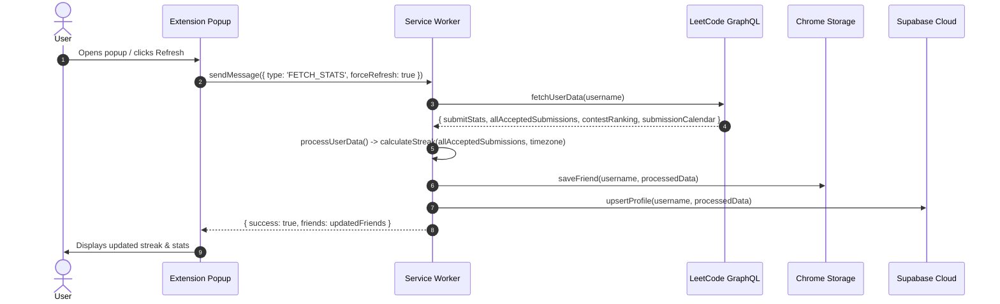
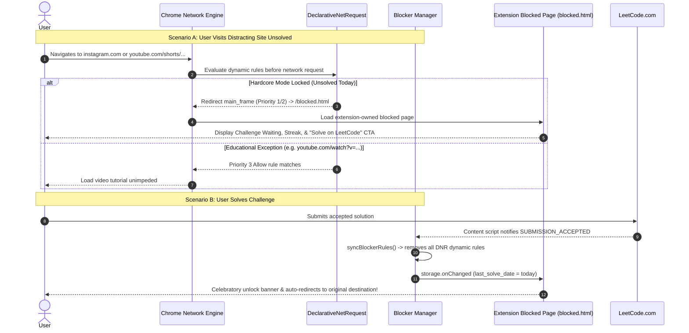
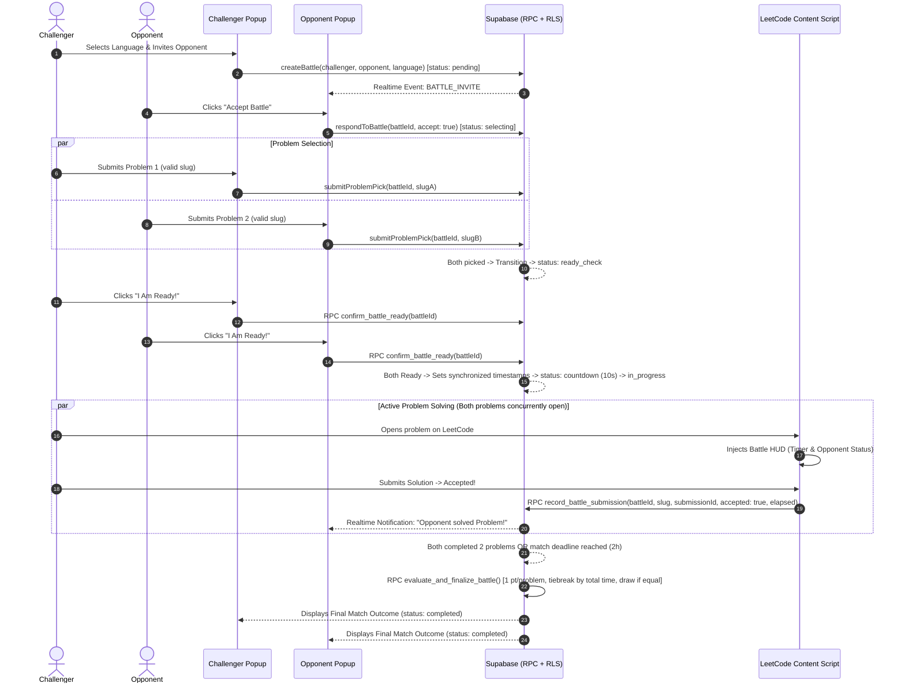
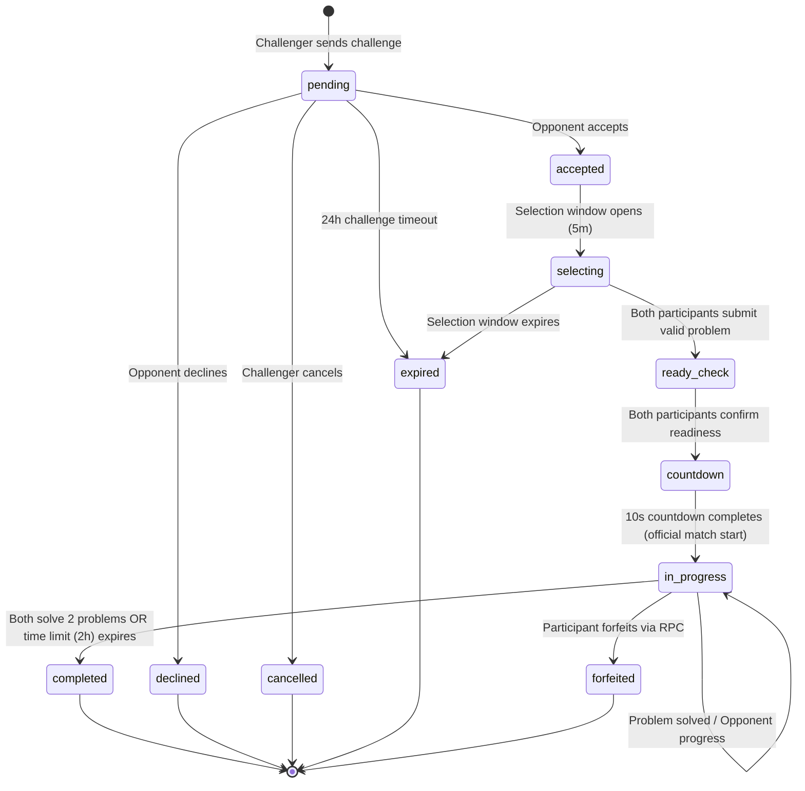
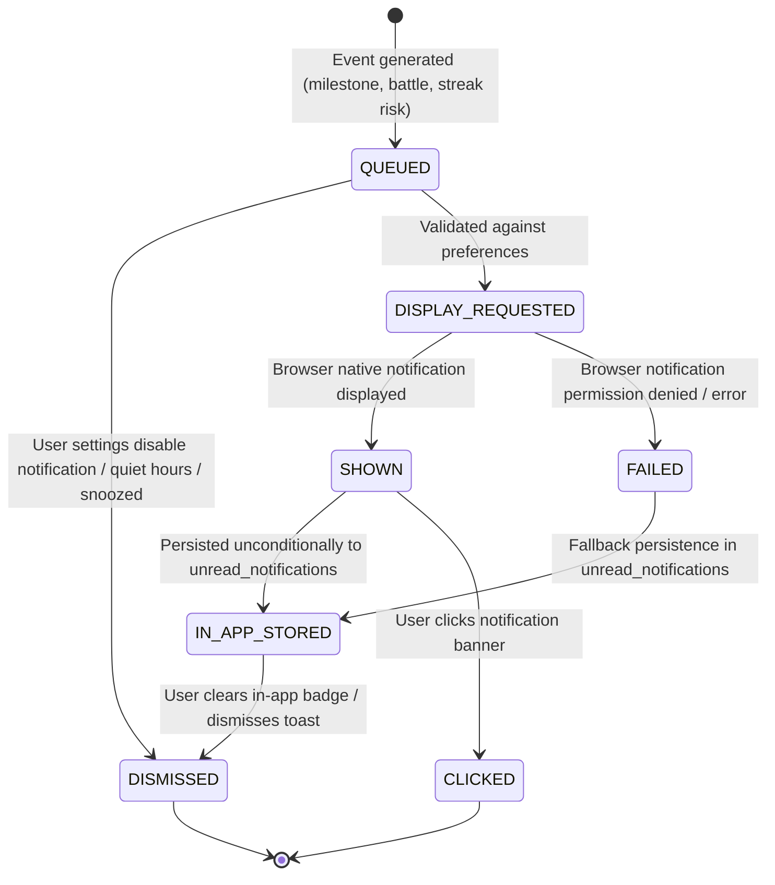

# LeetStreak Low-Level Design (LLD)

**Version:** 1.0.0  
**Status:** Approved  
**Author:** Principal Software Architect & Full-Stack Specialist  
**Codebase Reference:** `src/shared/`, `src/background/`, `src/content/`, `src/popup/`

---

## 1. Module & Component Architecture

### 1.1 Personal Streak Engine (`src/shared/streak-calculator.js`)
- **Responsibilities:**
  - Receive normalized accepted submissions from LeetCode.
  - Map timestamps to calendar days in the user's persisted IANA timezone.
  - Calculate `currentStreak` (consecutive solve days ending today or yesterday).
  - Calculate `longestStreak` (monotonic maximum streak sequence achieved).
  - Detect streak risk (active streak > 0 but no accepted solve recorded today).
- **Inputs:** `allAcceptedSubmissions` (Array of `{ timestamp, titleSlug, title }`), `userTimezone` (String, default detected).
- **Outputs:** `{ currentStreak: number, longestStreak: number, isStreakAtRisk: boolean, solveDates: string[] }`.
- **Validation Rules:**
  - Failed submissions (Wrong Answer, TLE, etc.) are filtered out.
  - Multiple accepted submissions on the same calendar day count as one day.
  - If the latest solve was before yesterday, `currentStreak = 0`.

### 1.2 Centralized Notification Manager (`src/shared/notification-manager.js`)
- **Responsibilities:**
  - Validate dispatch against user preferences (`notifications_enabled`, quiet hours, snooze).
  - Deduplicate event alerts within rolling 24-hour windows.
  - Persist unread notification records in `chrome.storage.local` for in-app fallback.
  - Dispatch native Chrome desktop notifications (`chrome.notifications.create`).
  - Track delivery states: `QUEUED`, `DISPLAY_REQUESTED`, `FAILED`, `DISMISSED`, `CLICKED`.
- **Interface:**
  - `dispatchNotification(event: NotificationEvent): Promise<DispatchResult>`
  - `getUnreadNotifications(): Promise<NotificationItem[]>`
  - `markNotificationDismissed(id: string): Promise<void>`
  - `setSnooze(hours: number): Promise<void>`

### 1.3 Hardcore Blocker Manager (`src/background/blocker-manager.js` & `tab-monitor.js`)
- **Responsibilities:**
  - Manages Manifest V3 `chrome.declarativeNetRequest` dynamic rules for network-level main-frame blocking.
  - Enforces priority hierarchy: Priority 10 (System Whitelist), Priority 5 (User Allowlist), Priority 3 (Educational Exceptions), Priority 2 (Path-specific blocks), Priority 1 (Domain blocks).
  - Listens to `chrome.webNavigation.onHistoryStateUpdated` to intercept SPA route changes to restricted paths (e.g. YouTube Shorts).
  - Evaluates canonical solve-to-unlock condition via `hasSolvedToday()` and persisted IANA timezone.
  - Removes all dynamic blocking rules from Chrome's network engine upon verified accepted LeetCode solve.
  - Renders extension-owned motivational block page (`blocked.html`) with sanitized return URLs.
  - Manage session state in `chrome.storage.session` to survive service worker restarts.

### 1.4 Authoritative 1v1 Battle Manager (`src/shared/battle-manager.js`)
- **Responsibilities:**
  - Room creation with locked programming language.
  - Two-way invitation management (pending, accepted, declined, expired, cancelled).
  - Problem selection: Player A contributes 1 problem, Player B contributes 1 problem (2 total).
  - Validate problem slugs against LeetCode GraphQL before locking.
  - Ready-check confirmation and synchronized match countdown.
  - Verification of accepted submissions and opponent broadcast.
  - Deterministic scoring: 1 point per problem; tiebreaker by total accepted completion time.

---

## 2. Sequence Diagrams for Critical Flows

### 2.1 Personal Progress Synchronization & Streak Recalculation



### 2.2 Hardcore Mode Solve-to-Unlock & Network-Level Website Restriction



### 2.3 1v1 Battle: Creation to Match Completion



---

## 3. State Machines

### 3.1 1v1 Battle Canonical State Machine



### 3.2 Notification Delivery Lifecycle



---

## 4. Interface & Runtime Messaging Contracts

Messages between content scripts, popup, options, and service worker follow a strict contract:

```typescript
type MessageType =
  | 'PING'
  | 'FETCH_STATS'
  | 'ADD_FRIEND'
  | 'REMOVE_FRIEND'
  | 'GET_FRIENDS'
  | 'ADD_TO_QUEUE'
  | 'SHOW_NOTIFICATION'
  | 'BATTLE_GET_STATUS'
  | 'BATTLE_CHALLENGE'
  | 'BATTLE_RESPOND'
  | 'BATTLE_PICK_PROBLEM'
  | 'BATTLE_READY'
  | 'BATTLE_SUBMISSION'
  | 'BATTLE_FORFEIT'
  | 'BATTLE_CANCEL'
  | 'BATTLE_VALIDATE_PROBLEM'
  | 'GET_LOGGED_IN_USER'
  | 'SEND_ROAST'
  | 'FETCH_PENDING_ROASTS'
  | 'CLEAR_ROASTS';

interface RuntimeMessage<T = unknown> {
  type: MessageType;
  payload?: T;
}

interface RuntimeResponse<T = unknown> {
  success: boolean;
  data?: T;
  error?: string;
}
```

---

## 5. Algorithm Design & Complexity

### 5.1 Personal Streak Calculation Algorithm
- **Time Complexity:** $O(N \log N)$ where $N$ is the number of accepted submissions (due to initial timestamp sorting), followed by $O(D)$ where $D \le N$ is unique calendar days.
- **Space Complexity:** $O(D)$ for unique sorted date strings.
- **Algorithm:**
  1. Extract Unix timestamp from each item in `allAcceptedSubmissions`.
  2. Convert timestamp to calendar date `YYYY-MM-DD` using the user's configured IANA timezone via `Intl.DateTimeFormat`.
  3. Deduplicate dates into a sorted ascending array `sortedDates`.
  4. Iterate backwards starting from current date or yesterday:
     - Check for consecutive day gaps: `expectedDate - 1 day == actualDate`.
     - Continue incrementing `currentStreak` until a gap is encountered.
  5. Scan forward from beginning to compute `longestStreak = max(runLengths)`.

### 5.2 Deterministic 1v1 Battle Scoring Algorithm
- **Inputs:** `challengerResults`, `opponentResults` (submissions for problem 1 and problem 2).
- **Rules:**
  1. Each accepted problem grants **1 point**.
  2. Player with greater points wins:
     - If `pointsA > pointsB` $\implies$ Winner: Player A.
     - If `pointsB > pointsA` $\implies$ Winner: Player B.
  3. If points are equal (e.g., both 2 points or both 1 point):
     - Compute total accepted completion time: $T = \sum t_i$ for all accepted problems.
     - If $T_A < T_B \implies$ Winner: Player A.
     - If $T_B < T_A \implies$ Winner: Player B.
     - If $T_A == T_B \implies$ Draw.
  4. If neither solved any problem $\implies$ Draw.

