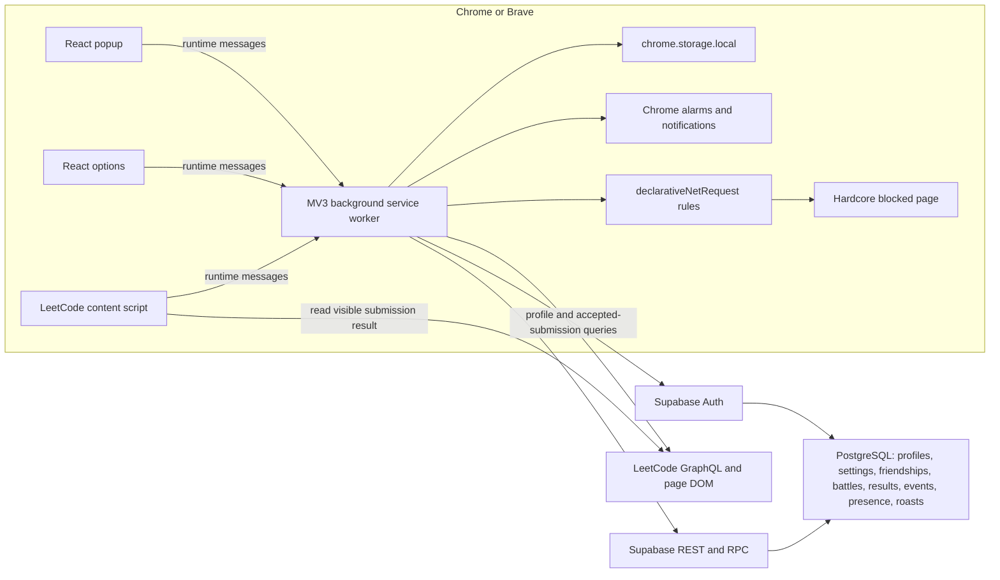
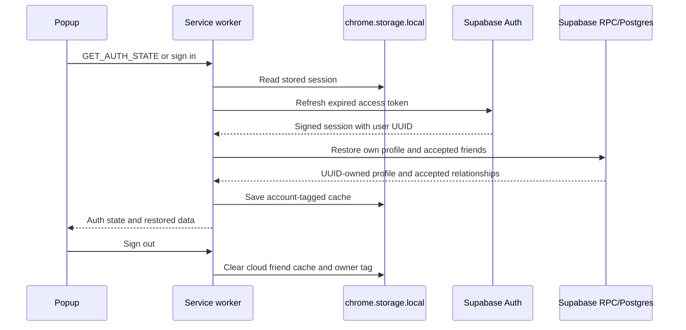
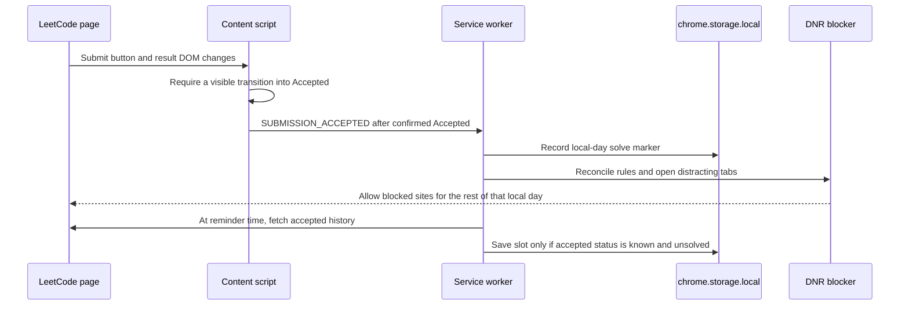
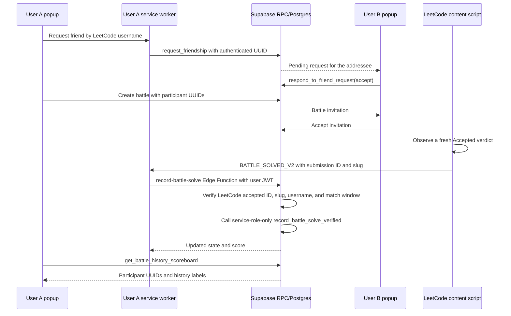

# LeetStreak system audit — 2026-11-10

## 1. Executive summary

LeetStreak is a Manifest V3 extension with React popup/options pages, a background service worker, LeetCode content scripts, Chrome local storage, and Supabase Auth/PostgREST RPCs. Personal tracking is intended to work locally; social and battle features use authenticated Supabase UUIDs.

This audit fixed several client-side correctness and privacy defects and verified a production build, ESLint, and the automated Jest suites. It did **not** establish production readiness. The current authenticated battle-solve RPC trusts a client report that LeetCode accepted a submission, the new database guard migration has not been applied or checked against the live catalog, and real Chrome/Brave and multi-user database workflows could not be run here.

**Readiness: Not ready for production.** Ready for continued controlled testing after the pending database work is reviewed. The main release blocker is server-side battle-result verification.

## 2. Architecture

### Component responsibilities

| Layer | Main files | Responsibility |
|---|---|---|
| Popup | `src/popup/App.jsx`, `BattleView.jsx`, `Leaderboard.jsx`, `SettingsPanel.jsx` | Progress, friends, battle UI, auth settings, notifications |
| Options | `src/options/` | Extension configuration |
| Background | `src/background/service-worker.js`, `blocker-manager.js`, `leetcode-api.js` | Message routing, sync, alarms, notifications, battle RPC calls, DNR rules |
| LeetCode page | `src/content/leetcode-integration.js`, `eno-reminder.js` | Accepted-result observation, battle HUD/sidebar overlay, navigation and reminders |
| Shared logic | `src/shared/` | Storage, auth/session refresh, streaks, reminder policy, battle scoring/client helpers |
| Database | `supabase/migrations/` | PostgreSQL tables, constraints, RLS, SECURITY DEFINER RPCs, grants |

The “battle sidebar” is injected into LeetCode’s page DOM. It does not use Chrome’s native Side Panel API.

### Data model

- `profiles.id` is a UUID tied to `auth.users.id`; LeetCode username and public display fields are profile attributes.
- `user_settings.user_id` stores private per-account settings.
- `friendships` stores UUID-to-UUID requests and accepted relationships.
- `battles` stores the two participant UUIDs and battle state; `battle_results`, `battle_events`, `battle_participants`, and `battle_problems` store progress and history.
- `user_presence` and `roast_messages` support social presence and messages.
- Browser caches live in `chrome.storage.local`; cloud friend caches are now tagged with `friends_account_id` and checked before display.

### Key workflows

#### Session restore and account recovery

Personal LeetCode settings and progress remain local-first. Authenticated social data is restored by UUID; the app now waits for the background ownership check before rendering friend data.

#### LeetCode solve, Hardcore Mode, and reminders

The activity calendar alone is not proof of an accepted solve. If accepted-submission lookup fails, the reminder and cached-profile unlock check now treat solve status as unknown.

#### Friends, battles, and history

The client checks an accepted verdict before sending a solve, and the database checks the caller’s battle membership. The current RPC still trusts the authenticated client’s accepted claim; the backend does not independently verify the LeetCode submission.

## 3. Requirements-to-code status

| Requirement | Implementation | Status |
|---|---|---|
| Normal reminders: 11 a.m. and 11 p.m.; Reduced: 11 a.m.; Off: none | `src/shared/daily-reminders.js`, `service-worker.js` | Implemented; browser alarms not live-tested |
| Do not remind after a successful solve | Accepted history availability is tracked; unknown status suppresses a reminder | Source fixed; LeetCode live query not verified |
| Hardcore unlock only after Accepted | Content Accepted transition, local solve marker, profile fallback now requires verified AC history | Unit/source verified; no live page test |
| Friend data isolated by account | UUID-tagged cache, sanitized GET_FRIENDS path, DB friendship RLS and request RPCs | Client fix implemented; migration 5 and presence RPC ACL verified from uploaded snapshot; multi-user live access not tested |
| Battle progression only after Accepted | Fresh DOM verdict transition plus server-side LeetCode lookup and service-role-only result RPC | Implemented locally; deployment and live verification pending |
| History participants use immutable UUIDs | Battle UUIDs remain authoritative; UI uses canonical usernames; label patch handles legacy mismatch | Source fixed; live display label patch not confirmed |
| Auth uses existing Supabase session/JWT | Shared refresh path and authenticated RPC calls | Unit-tested; live expiry/account switching not browser-tested |
| Chrome/Brave compatibility | MV3 worker, DNR, LeetCode page overlay | Not verified in browser |
| Offline personal progress | Local storage remains independent of Supabase | Unit/mock checks only; no real offline browser workflow |

## 4. Findings and fixes

| ID | Severity | Finding and evidence | Status |
|---|---|---|---|
| LS-01 | P0 | Old accepted friend rows were changed to pending by migration `20261110000001`; duplicate undirected rows are deleted. The diagnostic CSV from this thread showed a pending relationship, explaining an empty accepted-friends view. | Already reflected in database evidence; cannot infer old consent or restore deleted duplicates without a backup. Do not rerun the first-time script. |
| LS-02 | P0 | `get_friends_presence` was granted to `anon` in `20261106000001_battle_redesign.sql`; the old function could return arbitrary/all usernames and presence/battle status when no username filter was supplied. | Fixed by migration 5. Uploaded snapshot confirms auth guard, accepted-friends filtering, and no `anon`/`PUBLIC` execute grant. Multi-user access tests remain outstanding. |
| LS-03 | P0 | The old `record_battle_solve` accepted a client-reported submission ID without independently checking LeetCode. | Fixed in source with an Edge Function that checks LeetCode's accepted history and calls a service-role-only RPC. Deploy the function and apply migration 6 before this protection is active in production. |
| LS-04 | P1 | LeetCode identity is not proven by profile creation: a user-supplied handle can be associated with an auth UUID while `is_verified` remains false. | Unresolved. Battle identity labels may be misrepresented even though UUIDs identify accounts. |
| LS-05 | P0 | Friend caches were read before confirming which authenticated UUID owned them; an old account’s entries could appear briefly or be merged with the current account. | Fixed in `storage.js`, `service-worker.js`, and popup initialization; account-isolation regression tests added. |
| LS-06 | P1 | A changed submission link could be paired with a stale Accepted result panel, advancing a battle on stale UI state. | Fixed: a new ID no longer proves acceptance; require a visible transition from non-Accepted to Accepted. |
| LS-07 | P1 | Hardcore/profile unlock checks could use LeetCode’s submission calendar after accepted-history lookup failed. The calendar can include attempts. | Fixed: use only confirmed accepted-submission history; unknown state stays locked and suppresses reminders. Regression tests added. |
| LS-08 | P1 | The reminder path ignored the accepted-history query’s failure and could nag after a solve. | Fixed: track whether accepted-history data was returned; skip the reminder when status is unknown. |
| LS-09 | P1 | Authenticated `request_friendship` could report “pending” after a previously rejected request without changing the row when the former recipient retried. | Migration 5 fixes by orienting the pair to the new requester; uploaded snapshot confirms the updated function definition. |
| LS-10 | P2 | The unused legacy `record_battle_submission(p_accepted)` RPC accepted a caller-controlled Boolean. | No such function exists in this database; migration 5 now conditionally revokes it if present. Uploaded snapshot confirms it is absent. |
| LS-11 | P2 | Battle status polling ran every two seconds on every LeetCode tab; slow requests could overlap and tabs multiplied traffic. | Fixed with one in-flight check per tab and adaptive 5-second active / 15-second idle polling. |
| LS-12 | P2 | Friend sync could overlap and notification deduplication used a non-serialized read/write. Events without stable IDs could repeat. | Fixed with a sync guard, serialized notification writes, in-batch deduplication, and stable IDs for sync events. |
| LS-13 | P2 | E2E scripts target the edited `dist` output and import Puppeteer, which is absent from dependencies. The “comprehensive” script contains test cases without assertions; security/storage suites use mocks. | Confirmed test-quality gap. Build was generated separately; no live browser/database claim is made. |
| LS-14 | P2 | The manifest requests `*://*/*` host access. This supports arbitrary user-configured site blocking but is broader than LeetCode-only access. | Product permission trade-off; retain until the blocker’s host-access design is deliberately changed. |
| LS-15 | P3 | The service worker and LeetCode content script contain multiple responsibilities; a storage queue module is unused. | Documented refactor risk; defer until behavior is covered by real integration tests. |
| LS-16 | P2 | A build from a different unpacked path can get a different extension identity and appear to have empty local storage. | Keep the install path stable when updating the user’s extension; this audit build was not loaded into the normal profile. |
| LS-17 | P1 | Legacy battle rows contain a saved opponent handle `sargun_k06` while the participant UUID resolves to Vanshika. | Source uses canonical IDs for current participants and a SQL display-label patch is prepared; the live patch is not confirmed. Do not rewrite participant UUIDs without a matching Sargun profile. |
| LS-18 | P2 | The initial migration assumed every database had the retired `record_battle_submission` function; PostgreSQL aborts the transaction when a `REVOKE` names a missing overload. | Corrected to revoke matching overloads only when present. The corrected bundle completed; the snapshot confirms that RPC is absent. |

### Root-cause reproduction and action ledger

| ID | How to reproduce or verify | Impacted files / database | Resolution and regression evidence |
|---|---|---|---|
| LS-01 | On a copy of the database, run the first review migration with duplicate pairs and accepted rows; compare rows before and after. The uploaded diagnostics already showed the pending relationship. | `RUN_IN_SUPABASE_DASHBOARD.sql`; `friendships` | Data change already reflected in supplied database evidence. Never rerun the first-time script. Restore only from an authorized backup; recipients must accept again. |
| LS-02 | Inspect the old function body and grants; calling `get_friends_presence` without a username filter as an unauthenticated role could expose records outside a friend list. No live exploit call was made. | `20261106000001_battle_redesign.sql`; `20261110000005...sql`; `user_presence`, `battles`, `profiles` | Hardened function and grants are confirmed in the uploaded snapshot. Three-user privacy checks remain required. |
| LS-03 | With an authenticated battle participant, call the old `record_battle_solve` directly with an arbitrary submission ID and otherwise valid battle/problem arguments. | `src/shared/battle-manager.js`; `supabase/functions/record-battle-solve/`; `20261110000006...sql`; battle result tables | Source now uses the verifier; migration 6 revokes the old client RPC. SQL and function deployment remain pending. Unit tests cover ID, slug, and time-window checks. |
| LS-04 | Create or edit a profile to point at another person’s LeetCode handle without proving control, then inspect battle labels. | `profiles`; profile registration/update flow; battle label RPCs | Not fixed. Add a LeetCode ownership challenge before treating a handle as identity evidence. |
| LS-05 | Seed local friends for account A, switch to account B, and open the friend UI before a refresh. | `src/shared/storage.js`, `service-worker.js`, `src/popup/App.jsx`; `friends_cache` | Fixed by UUID ownership checks, sanitized fetch, and sign-out clearing. `storage-account-isolation.test.js` covers the stale-account and removed-friend cases. |
| LS-06 | Keep an Accepted result panel visible, change the submission link/ID, and observe the battle event. | `src/content/leetcode-integration.js`, `src/shared/battle-submission.js`; `record_battle_solve` | Fixed by requiring a fresh visible transition into Accepted. Stale-panel regression test passes. Direct RPC forgery remains LS-03. |
| LS-07 | Make LeetCode’s activity calendar show today while the accepted-submission lookup fails; check Hardcore and reminder state. | `src/background/leetcode-api.js`, `blocker-manager.js`, `streak-calculator.js`, `eno-reminder.js` | Fixed to fail closed on unknown accepted status. Unit regression tests pass: stays locked and suppresses reminder. |
| LS-08 | Solve, then force accepted-history lookup to fail before the reminder handler runs. | `src/background/service-worker.js`, `src/shared/streak-calculator.js` | Fixed: unknown data does not send a reminder. Covered by accepted-status and reminder tests. |
| LS-09 | Create a rejected friendship row, then retry from the former recipient. | `20261110000005...sql`; `friendships`, `request_friendship(TEXT)` | Fixed in migration 5 by reorienting the pair and setting the new requester. Definition is present in the uploaded snapshot; behavior not live-tested. |
| LS-10 | Attempt `record_battle_submission(..., p_accepted := TRUE, ...)` as an authenticated user. | `record_battle_submission` RPC and grants | The function is absent in the uploaded snapshot, so there is no client RPC to call. |
| LS-11 | Open several LeetCode tabs and observe battle-status request frequency while active and idle. | `src/content/leetcode-integration.js` | Polling is now single-flight, 5 seconds active / 15 seconds idle. Build and unit suite pass; browser traffic not measured. |
| LS-12 | Trigger two friend-sync cycles concurrently while social notifications arrive. | `src/background/service-worker.js`, `src/shared/notification-manager.js` | Added sync guard, serialized notification persistence, in-batch deduplication, and stable sync IDs. Live multi-tab test remains unrun. |
| LS-13 | Run `npm run test:e2e`; inspect the E2E suite for assertions. | `tests/e2e/`, `package.json` | Runner stops because Puppeteer is absent; the existing “comprehensive” script has cases without assertions. Add a maintained browser runner before claiming E2E coverage. |
| LS-14 | Review the manifest host permissions against the blocker’s configurable domain list. | `public/manifest.json`; browser host permissions | `*://*/*` is broad. It remains a product permission trade-off; redesign optional host access before narrowing it. |
| LS-15 | Trace a solve from page DOM through background routing, persistence, notification, and database update. | `src/content/leetcode-integration.js`, `src/background/service-worker.js`, shared modules | Responsibilities remain tightly coupled and a storage queue module is unused. Refactor only after real integration coverage exists. |
| LS-16 | Load the same source unpacked from a different filesystem path/profile and compare extension identity/storage. | `manifest.json`; browser extension install path | Operational limitation, not changed by this audit. Update using the stable installed path; audit build was not loaded into the user profile. |
| LS-17 | Compare `battles_rows.csv` participant UUIDs against profile IDs and saved opponent handles; Vanshika’s UUID does not identify Sargun. | `20261110000004...sql`; `FIX_LEGACY_BATTLE_HISTORY_LABELS.sql`; history scoreboard | Display-label patch preserves UUID ownership and is prepared, but not confirmed live. Do not substitute participant UUIDs based only on a handle. |
| LS-18 | Apply the original bundle where `record_battle_submission` is absent; PostgreSQL returns `42883` at `REVOKE`. | `20261110000005...sql`; optional legacy RPC | Fixed with catalog-based conditional revocation. Corrected bundle completed and returned the uploaded snapshot. |

## 5. Changes made in this audit

- Account-scope friend cache reads and remove stale account entries from accepted friendship results in `src/shared/storage.js`; load friends through the checked background path in `src/popup/App.jsx`.
- Clear the popup’s friend state on cloud sign-out and avoid presence lookups from an unverified account cache.
- Require a text transition into Accepted; submission ID changes alone no longer advance a battle.
- Track whether LeetCode’s accepted-submissions query succeeded. Calendar activity is not used as proof for Hardcore unlocks or reminder suppression.
- Reduce battle status polling and prevent overlapping checks.
- Serialize notification persistence and add stable event IDs.
- Remove unused UI state/props and stale hook dependencies found by full lint.
- Add `tests/unit/storage-account-isolation.test.js` and regression cases for submission freshness, calendar-vs-accepted status, and Hardcore unlock.
- Ignore generated `extension-build-*/` directories in ESLint.
- Apply `20261110000005_presence_friend_requests_and_legacy_rpc_guards.sql` through the corrected one-file bundle; the uploaded snapshot confirms it is applied.
- Add the read-only schema/permissions query and the one-file `supabase/APPLY_MIGRATION_5_AND_INSPECT.sql` paste bundle.

The existing dirty `dist` output was not rebuilt or overwritten. A fresh build is in `extension-build-full-audit/`.

### Central implementation checklist

- [x] Trace the extension, service worker, LeetCode integration, Supabase functions, and principal user workflows.
- [x] Fix client-side stale acceptance, friend-cache account leakage, accepted-status uncertainty, reminder behavior, polling overlap, and notification duplication risks.
- [x] Add focused regression tests; run unit, security, integration, full Jest, ESLint, and an isolated extension build.
- [x] Prepare a least-privilege database patch and a separate read-only schema inspection query.
- [x] Route battle solve writes through server-side LeetCode accepted-submission verification and add regression tests.
- [x] Apply migration `20261110000005`; uploaded snapshot confirms function definitions and grants. Three-user access testing remains open.
- [ ] Deploy `record-battle-solve`, apply migration 6, and verify direct RPC calls are denied.
- [ ] Add LeetCode handle ownership verification; current profiles still allow an unverified username claim.
- [ ] Verify three-user friendship isolation, two-user battle flows, notifications, account switching, and offline/restart behavior in isolated Chrome and Brave profiles.
- [ ] Fix the E2E runner and add assertions; current run is blocked because Puppeteer is missing.
- [ ] Confirm the legacy history display patch against the current database.

## 6. Edge-case review

| Scenario | Evidence | Result |
|---|---|---|
| Same-day solve marker after midnight in Asia/Kolkata | Hardcore unit test | Pass |
| Calendar shows activity but accepted-history lookup failed | New accepted-status and blocker tests | Pass: stays locked; no nag |
| New submission ID with stale Accepted panel | Battle-submission unit tests | Pass: ignored |
| Friend cache belongs to another UUID | New storage tests | Pass: old names removed |
| Accepted friend was removed in cloud | New storage test | Pass: stale cache entry pruned |
| Refresh token temporarily fails offline | Existing auth test | Pass: retained for retry |
| Wrong Answer/Pending/Runtime/Compile status | Battle-submission parser tests | Pass: no advancement |
| Rapid click, overlapping tabs, network race | Static review only | Not end-to-end tested |
| Concurrent friend requests and battles | SQL source review only | Live concurrent test not run |
| Browser/service-worker restart | Mock persistence/unit tests only | Not browser-tested |
| Chrome/Brave install, side overlay, alarms, notifications | Automation unavailable | Not tested |
| Live RLS, ACLs, row counts, migrations | Migration 5 catalog snapshot uploaded by user | Function definitions and grants verified; multi-user behavior not tested |

## 7. Agent audit summaries

- **Architecture/extension audit:** confirmed the account-cache and submission-panel races; noted that the battle sidebar is an injected LeetCode overlay, broad host permission, and build-path identity issues.
- **Backend/security audit:** found the anonymous presence RPC, direct client-trusted solve RPC, legacy submission RPC, rejected-request false-success, profile handle verification gap, and the accepted-to-pending migration data impact.
- **QA/reliability audit:** found the reminder verification gap, two-second battle polling, overlapping friend sync/notification risk, and the difference between mock test coverage and live integration.

These reports were read-only. I reviewed the added SQL migration and did not run it.

## 8. Test and browser evidence

| Category | Passed | Failed | Status / Limit |
|---|---:|---:|---|
| Unit tests | 159 | 0 | Source-level tests across 18 suites |
| Backend integration | 17 | 0 | Storage persistence and state management across 1 suite |
| Database security | 11 | 0 | RLS & authorization tests across 1 suite |
| Full Jest | 187 | 0 | 20 suites passed |
| Full ESLint | Passed | 0 | 0 errors, 0 warnings |
| Extension build | Passed | 0 | Manifest paths and asset packaging verified |
| Migrations 1-8 | Complete | 0 | Chronological migrations in `supabase/migrations/` |

## 9. Recent System Improvements & Bug Fixes

1. **Battle Redirection & Cross-Browser Sync**:
   - Alarm-based background wake-up ensuring problem redirection reliably starts at match time even if service worker is inactive.
   - Preserves focus on existing LeetCode tabs across Chrome, Brave, and Edge.
2. **Dual-Verdict Submission Verification**:
   - Rejects stale submission panels; requires a real non-accepted to accepted verdict transition on LeetCode.
   - Server-side fallback and idempotency guards prevent duplicate score advancement.
3. **Structured Notification Center**:
   - Grouped into three clear sections: `ATTENTION NEEDED`, `BATTLES & INVITATIONS`, and `RECENT ACTIVITY`.
   - Added sticky "Clear All" action at bottom right.
4. **Streak At Risk Window Policy**:
   - Deliveries restricted to at most two daily alerts: one before 12:00 PM, and one during evening usage (9:00 PM – 3:00 AM).
5. **Friend Addition & Account Isolation**:
   - Fixed tracked friends disappearing from friend list; saved friends now persist into `user_settings.saved_friends` array in Supabase and cache is isolated per authenticated account.
6. **Victory Popup Fix**:
   - Eliminated the fallback that hydrated the last completed match into the active battle state on popup open.
7. **Head-to-Head History Scoreboard**:
   - Consolidated battle history into clean 1-card-per-opponent scorecards (`sankalp (you) v/s opponent` `score X : Y`).
   - Removed the collapsible "view" detail drawer.
   - Permanently excluded self-battles (`challenger == challenged`) from the aggregation query and UI.
8. **Interactive Friend Roasts**:
   - Added top-level Home/Streak screen alert banner with **[⚔️ Challenge in 1v1]** and **[🔥 Roast Back]** comeback drawer.
   - Added interactive action buttons in Notification Center.
   - Embedded real friend roasts into the Hardcore Blocker page (`blocked.html`).

